# Multi-rotor UAV Combination Navigation System - Multi-source Information Fusion Algorithm (Matlab Code Implementation)

📚2 Running Results Edit
Edit
Edit
Edit
Edit
Edit
Edit
Edit
Edit
Part of the code:
% load UAV true trajectory data.  
addpath UavTrajectorySim;  
disp(' ')  
disp('Available UAV Truth Trajectory Data Files:')  
dir_mat_files = dir('UavTrajectorySim\*.mat');  
for nFile=1:length(dir_mat_files)
fprintf(' %d: %s\n',nFile,dir_mat_files(nFile).name);  
end  
% nFileChoice = input('Choose a UAV Truth data file (e.g. 1<Enter>): ');  
try  
%  load(dir_mat_files(nFileChoice).name)  
load(dir_mat_files(1).name)  
catch  
error('Selected UAV Truth Trajectory data file (%d) is invalid.\n',nFileChoice);  
end
gvar_earth;  
% Subsample number used in a single update  
nn = 2;  
% Sampling time  
ts = 0.01;  
nts = nn*ts;  
% Initial attitude, velocity, and position  
att0 = [0, 0, 90]'*arcdeg;  
vn0 = [0, 0, 0]';  
pos0 = [34*arcdeg, 108*arcdeg, 100]'; % Latitude, Longitude, Height  
qbn0 = a2qua(att0);  
% Attitude quaternion, velocity, and position  
qbn = qbn0;  
vn = vn0;  
pos = pos0;  
eth = earth(pos, vn);  
% Add error ***  
% Misalignment angle  
phi = [0.1, 0.2, 1]'*arcmin;  
qbn = qaddphi(qbn, phi);  
% Gyro bias, angle random walk  
eb_ref = [0.1, 0.15, 0.2]'*dph;  
eb = [0.01, 0.015, 0.02]'*dph;  
web = [0.001, 0.001, 0.001]'*dpsh;  
% Add bias, velocity random walk  
db_ref = [800, 900, 1000]'*ug;  
db = [80, 90, 100]'*ug;  
wdb = [1, 1, 1]'*ugpsHz;  
Qk = diag([web', wdb', zeros(1, 9)]')^2*nts;
rk = [0.1, 0.1, 0.1];
Rk = diag(rk)^2;
% Covariance matrix, x = [phi, delta_vn, delta_p, eb, db]
P0 = diag([[0.1, 0.1, 10]*arcdeg, [1, 1, 1], [10/Re, 10/Re, 10]...
[0.1, 0.1, 0.1]*dph, [80, 90, 100]*ug]')^2;
% Measurement matrix
Hk = [zeros(6,3), eye(6), zeros(6, 6)];
% Kalman filter initialization
kf = kfinit(Qk, Rk, P0, zeros(15), Hk);
% Simulation time duration consistent with the SD
kTime = fix(t_SD/ts);
err = zeros(kTime, 10);
xkpk = zeros(kTime, 2*kf.n + 1);
pos_ref = zeros(kTime,3);
pos_est = zeros(kTime,3);
pos_gps = zeros(kTime,3);
kk = 1;
t = 0;
for k = 2 : nn : kTime
    t = t + nts;
% Obtain the imu output corresponding to the simulated trajectory: angle rate and velocity rate (reference value)
    wm(1:nn,:) = imu_SD.wm(k-nn+1:k,:);
vm(1:nn,:) = imu_SD.vm(k-nn+1:k,:);  
% Add noise to the reference output of IMU
[wm1, vm1] = imuadderr(wm, vm, eb, web, db, wdb, ts);  
% Inertial Guidance Update: Attitude Quaternion, Velocity, and Position
[qbn, vn, pos, eth] = insupdate(qbn, vn, pos, wm1, vm1, ts);  
% Based on model prediction: Navigation error system model Kalman filter
kf.Phikk_1 = eye(15) + kfft15(eth, q2mat(qbn), sum(vm1, 1)'/nts)*nts;  
kf = kfupdate(kf);  
% Simulate GPS measurement data
gps = [avp_SD.vn(k,:)'; avp_SD.pos(k,:)'] + rk.*randn(6, 1);  
pos_gps(kk,:) = gps(4:6)';  
% Measurement update 5Hz
if mod(t, 0.2) < nts  
Zk = [vn', pos']' - gps;  
kf = kfupdate(kf, Zk, 'M');  
end  
% Indirect Kalman filter: feedback to IMU (feedback correction method)
qbn = qdelphi(qbn, kf.Xk(1:3));  
vn = vn - kf.Xk(4:6);  
pos = pos - kf.Xk(7:9);  
pos_est(kk,:) = pos';  
% Feedback correction: The prior estimation values of the Kalman filter are always zero due to the presence of feedback items. Ref: Wang Chenxi
kf.Xk(1:3) = 0;
kf.Xk(4:6) = 0;
kf.Xk(7:9) = 0;
kf.Xk(10:12) = 0;
kf.Xk(13:15) = 0;
% Compute the error between estimation and truth data
% Note that this 'error' is not the 'state vector' in the Kalman equation.
% In indirect Kalman filter, the 'state vector' means the error of  
% the IMU update (regardless of True data.)  
qbn_ref = a2qua(avp_SD.att(k,:));  
vn_ref = avp_SD.vn(k,:)';  
pos_ref(kk,:) = avp_SD.pos(k,:);  
xkpk(kk, :) = [kf.Xk', diag(kf.Pk)', t]';  
🎉3 References  
🌈4 Matlab code implementation

## Images

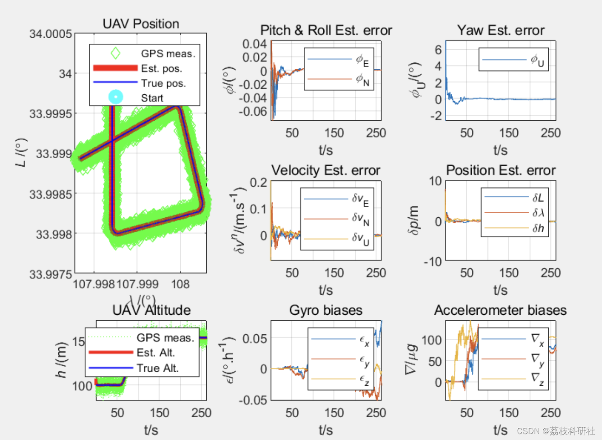
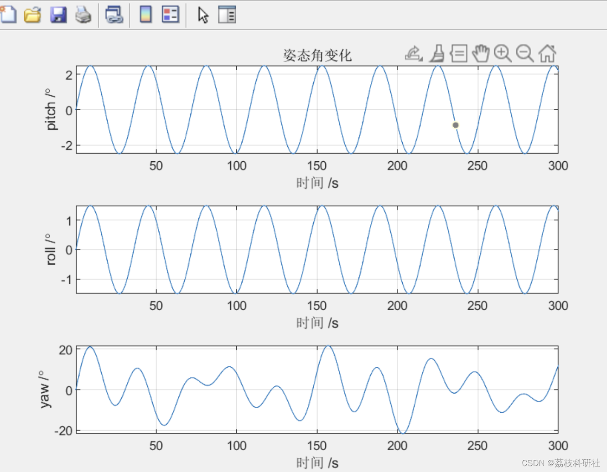
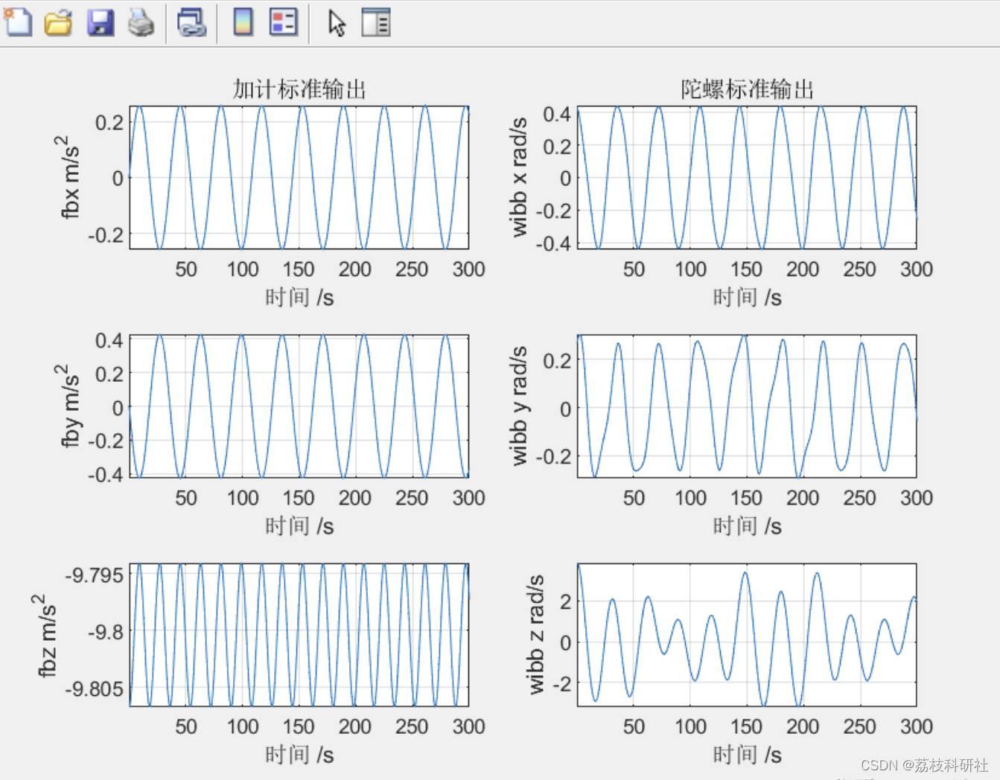
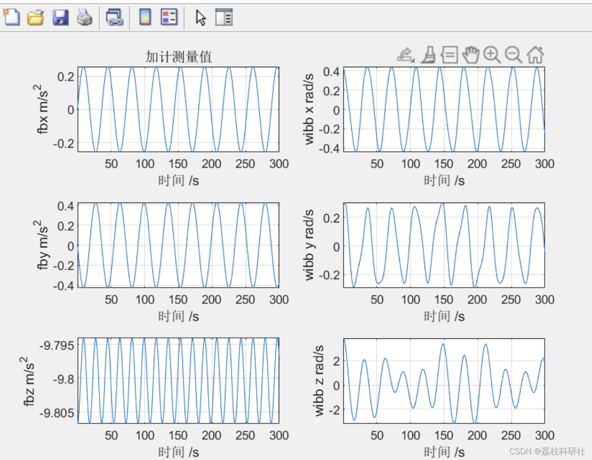
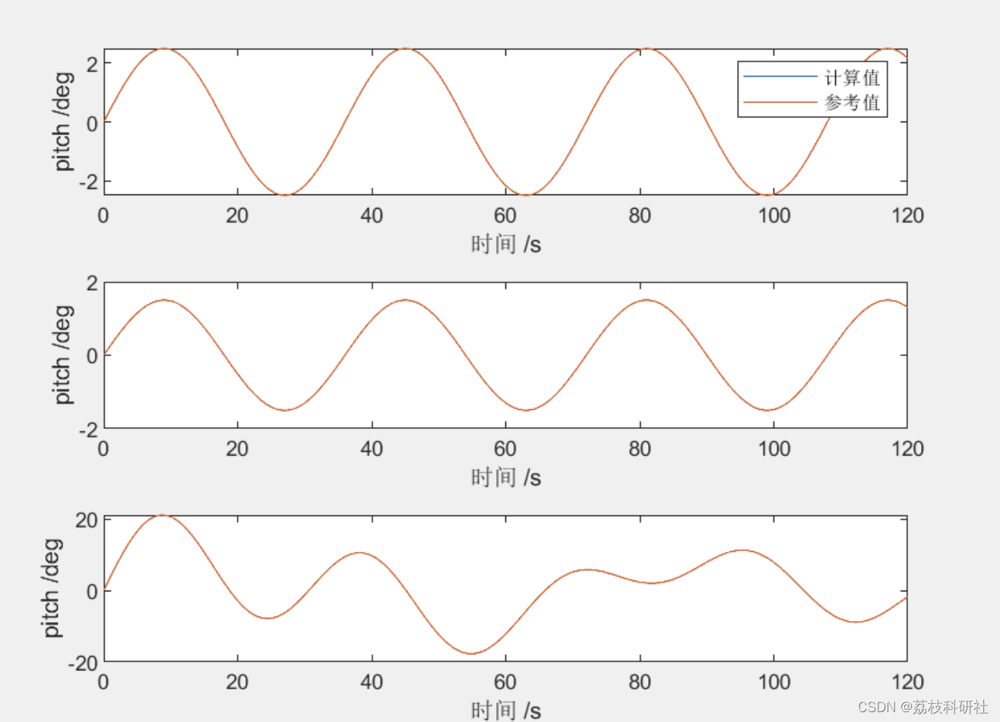
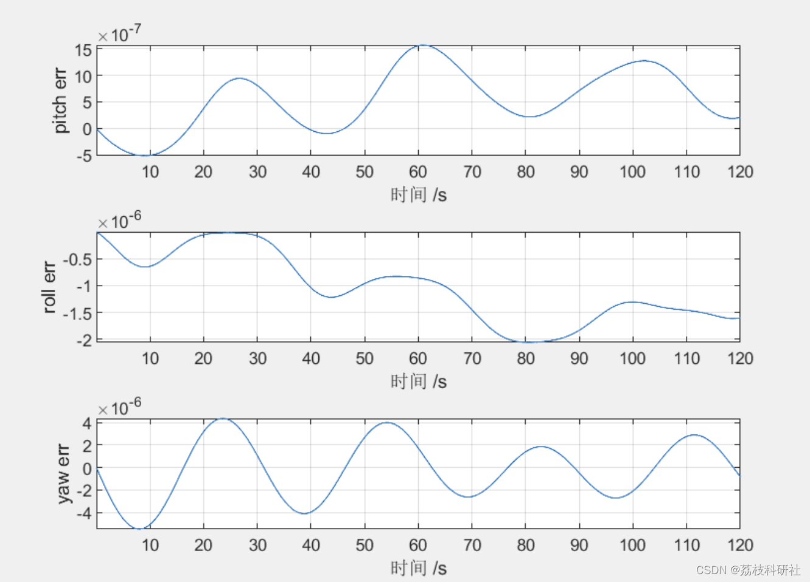
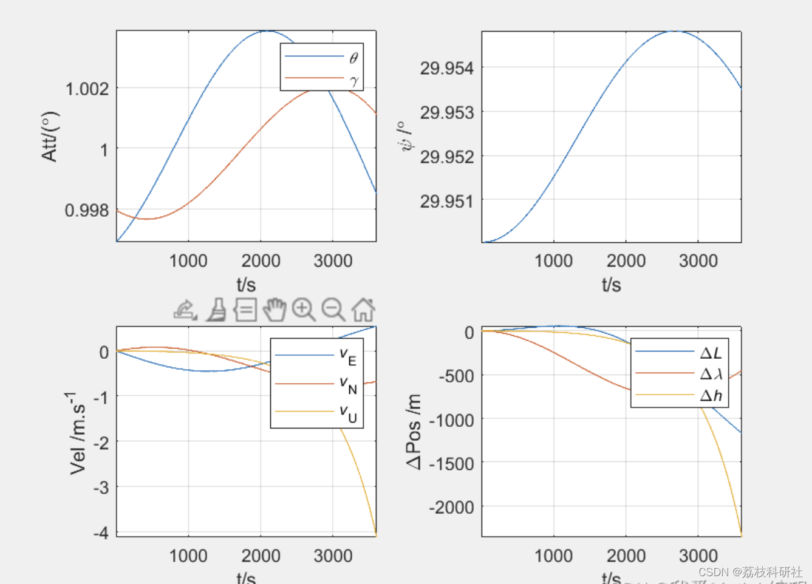
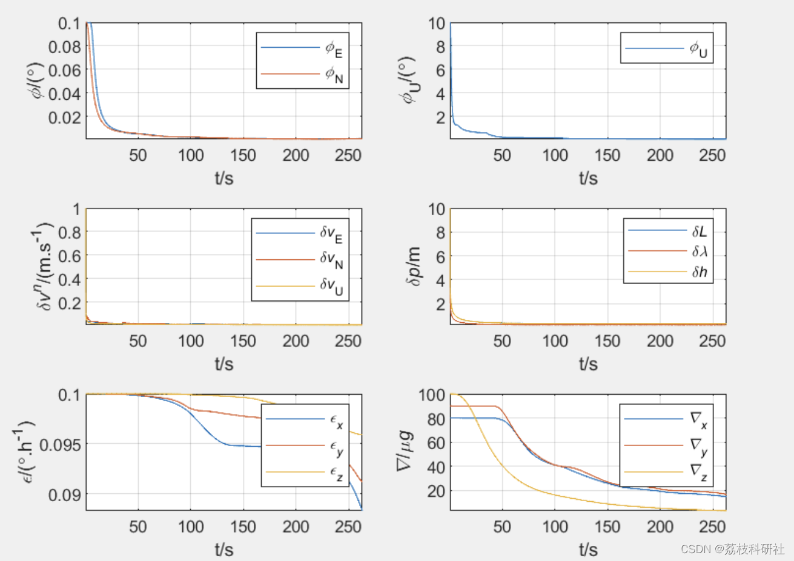
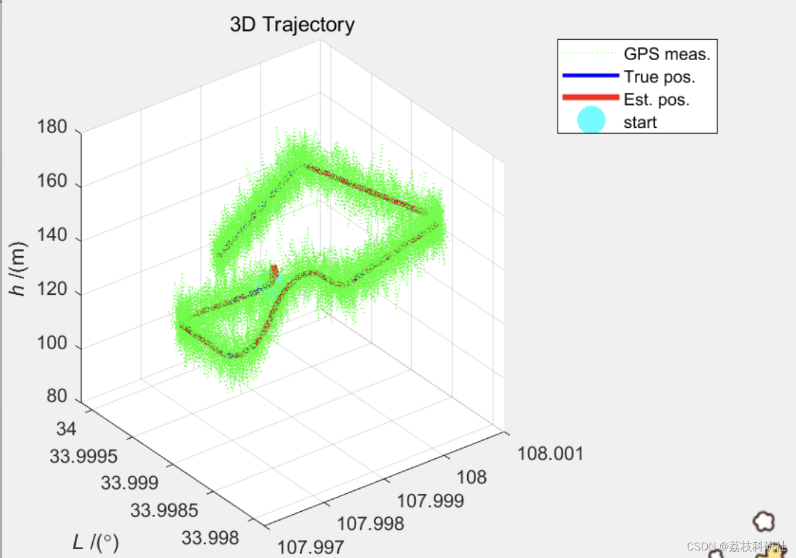
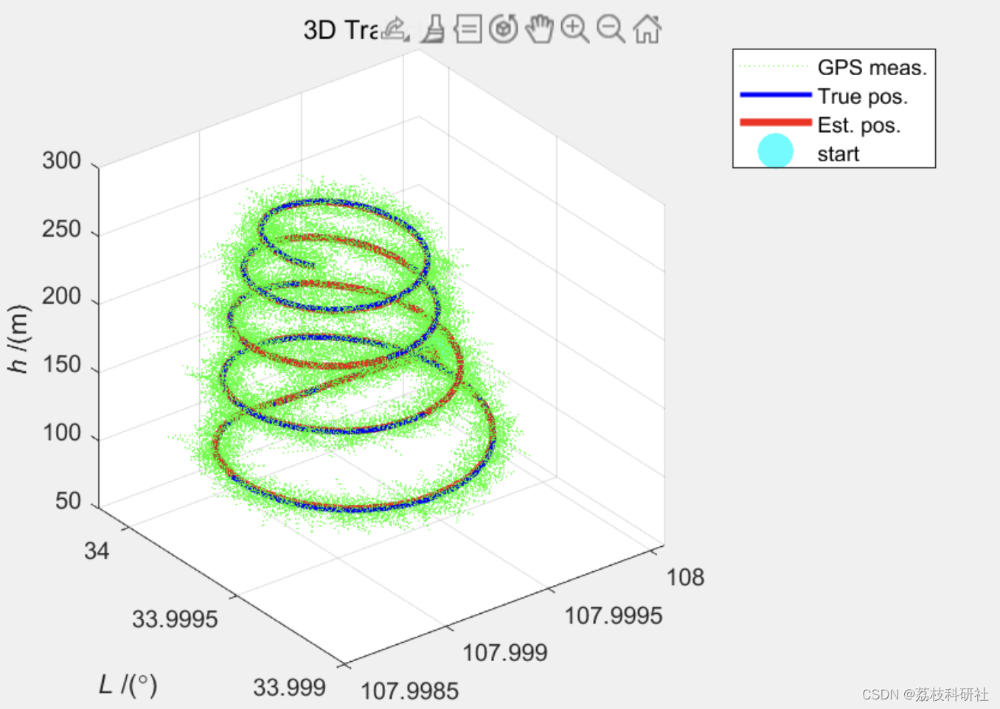
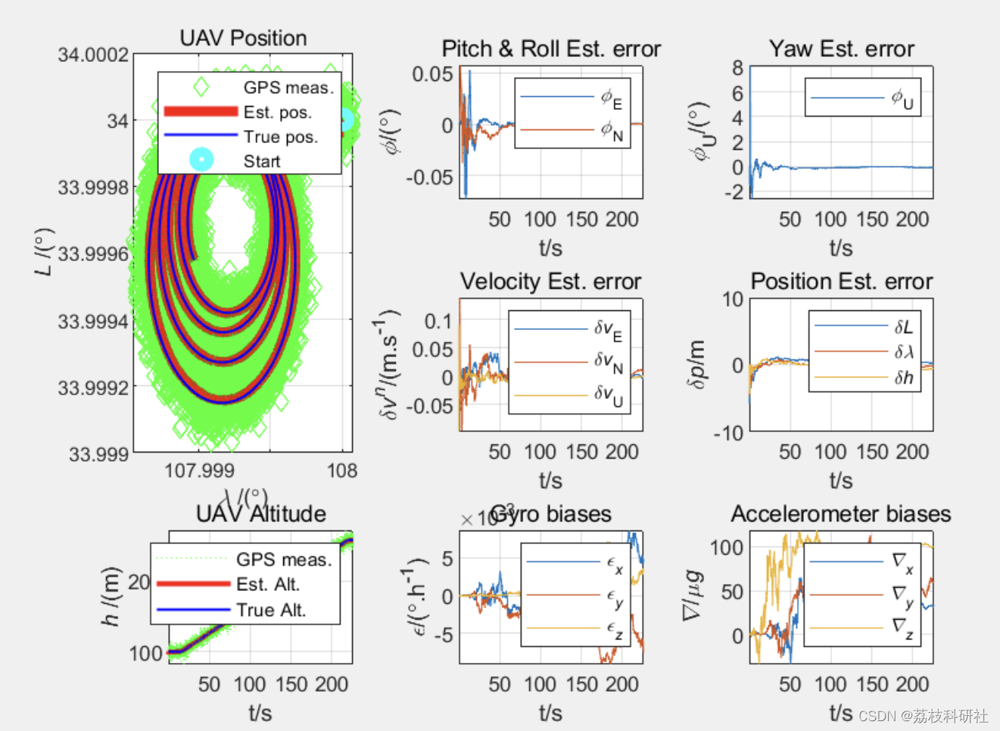
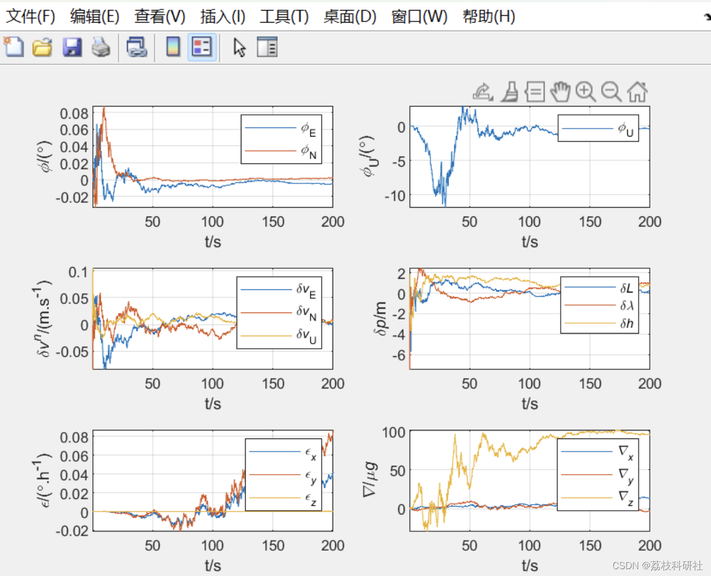

<!-- PAYMENT_BLOCK -->

## Get this dataset

- Payment link (Stripe): [Buy now](https://buy.stripe.com/3cs8yP7sY87d0vu9AB)
- Payment QR code: 

<!-- /PAYMENT_BLOCK -->
